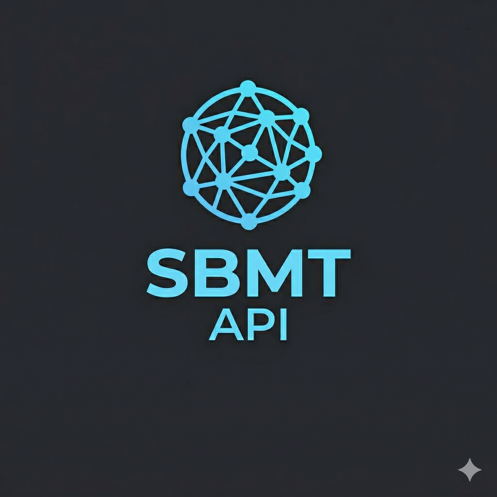
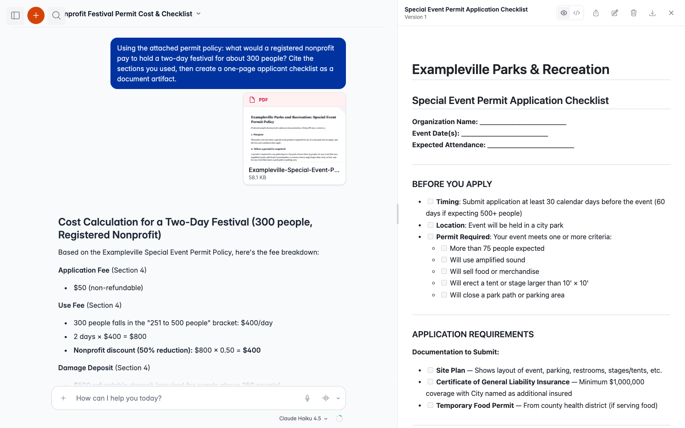
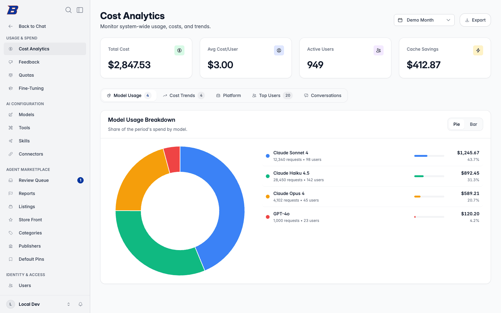
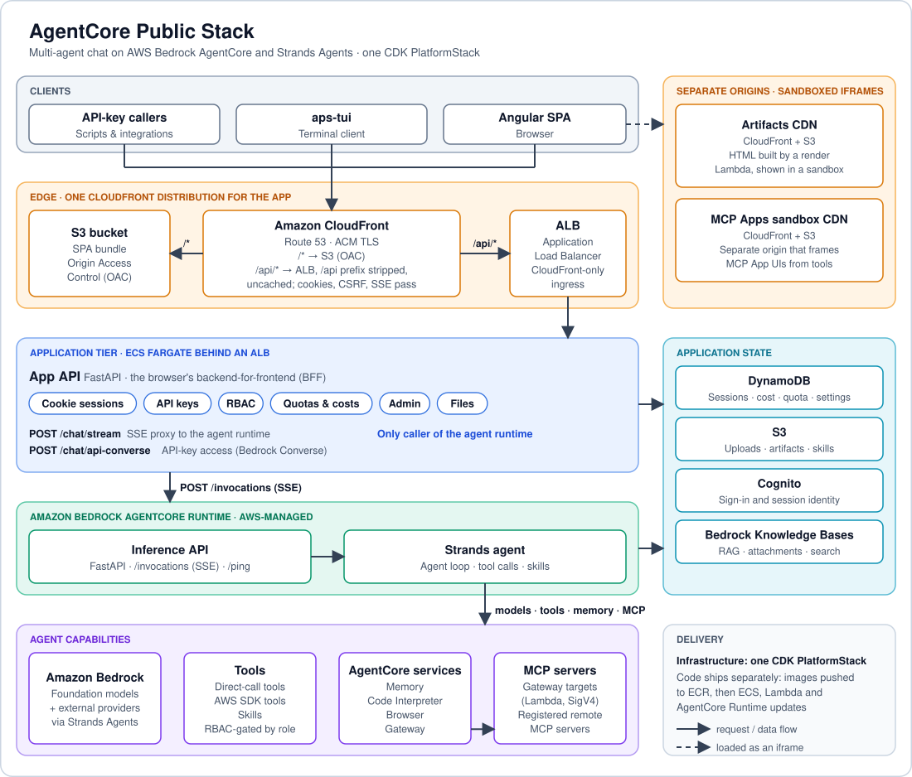
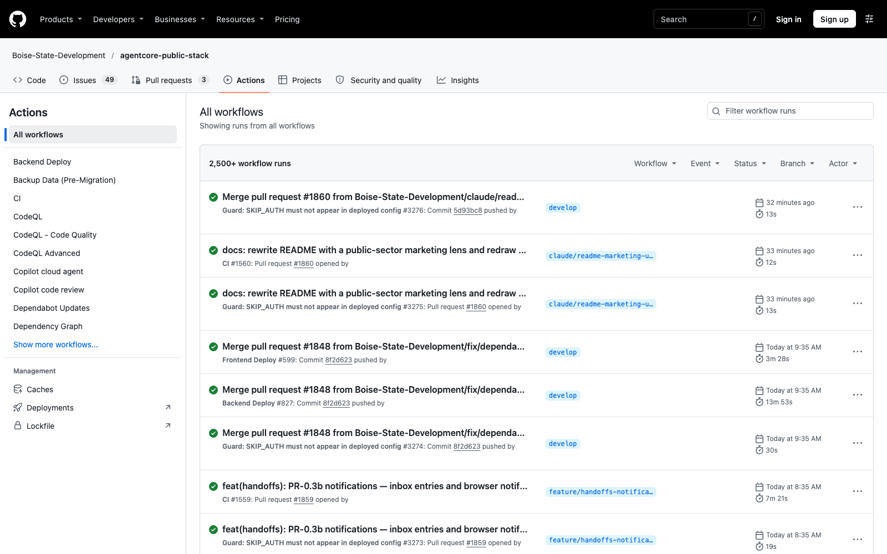

<div align="center">

<!-- IMAGE PLACEHOLDER: Animated GIF or hero banner showing the chat interface in action — a user asking a question, the agent streaming a response, and a tool rendering (e.g., a chart or an artifact opening in the side panel). ~800x400px, optimized for GitHub. -->
<!-- Example:  -->



<h1>AgentCore Public Stack</h1>

**The AI platform for public institutions on AWS.**
*Governed in code. Measured in public. Deployed in your own AWS account.*

Chat, agents, skills, tools and connectors on Amazon Bedrock AgentCore. Every model, tool and connector is a role grant your admins control, every model call is metered to the token, and every release publishes its quality, speed and cost, failures included. Source-available, and free for universities, public research and government. Built by Boise State University.

[](RELEASE_NOTES.md)
[](https://github.com/Boise-State-Development/agentcore-public-stack/actions/workflows/nightly.yml)
[](https://boise-state-development.github.io/agentcore-public-stack/)
[](https://boise-state-development.github.io/agentcore-public-stack/benchmarks/)


[Why](#-why-institutions-choose-this) · [Governance](#-governance-you-can-read) · [Benchmarks](#-measured-in-the-open) · [Built for AWS](#-built-for-institutions-whose-cloud-is-aws) · [Who It's For](#-built-for-the-public-sector) · [Features](#-what-you-get) · [Quotas](#-quotas-budgets-everyone-can-see) · [Admin Console](#-the-admin-console) · [Roadmap](#-roadmap) · [Architecture](#-architecture) · [Deploy](#-deployment) · [Docs](https://boise-state-development.github.io/agentcore-public-stack/)

</div>

---

> 🚀 **[Deploy it](.github/README-ACTIONS.md)** in your AWS account in under an hour, with no license to buy and no vendor to call · 📊 **[See the benchmarks](https://boise-state-development.github.io/agentcore-public-stack/benchmarks/)** and rerun them on your own deployment · 🛡️ **[Read the governance model](https://boise-state-development.github.io/agentcore-public-stack/configuration/governance/)**

---

<!-- IMAGE PLACEHOLDER: Screenshot of the chat interface showing a multi-turn conversation: (1) a user message with an uploaded PDF, (2) the assistant streaming a response with citations, (3) a generated chart or Word document opening in the artifacts side panel. ~900x500px. -->
<!-- Example:  -->

## 🤔 What Is This?

AgentCore Public Stack is the working codebase behind [boisestate.ai](https://boisestate.ai), the AI platform that serves students, faculty and staff at Boise State University. It packages **AWS Bedrock AgentCore** and **Strands Agents** into a complete, production-ready product: a polished chat experience, custom agents and skills, shared team workspaces, document intelligence, voice, a terminal client, and a full admin console for identity, access, quotas and cost.

Fork it, deploy it, brand it, and hand your whole organization an AI platform you run, without writing agent code. Everything is configured through the UI; the model, tool, connector and policy decisions stay yours, and every one of them is enforced by code you can read.

---

## 🎯 Why Institutions Choose This

Universities and public agencies share the same AI dilemma: per-seat subscriptions do not scale to a campus or a workforce, the data has to stay under institutional control, and the vendor landscape changes every quarter. This platform was built to answer exactly that.

| The problem | Our answer |
|-------------|------------|
| 💸 **Per-seat pricing doesn't scale to 30,000 people** | Consumption billing through the AWS account and agreement you already have. Pay for tokens used, not seats purchased |
| 🔐 **Student, employee and resident data must stay under your control** | Every conversation, document and knowledge base lives inside your AWS account. Models are used for inference only and never train on your data |
| 🔒 **Betting the institution on one vendor** | Choose your models. Claude, Nova, Llama and Mistral from Bedrock, plus GPT and Gemini, curated by your admins, governed by role and swapped without a redeploy |
| 🧩 **Dozens of systems, none of them talking to the AI** | Any MCP server, registered from the admin console. Sign-in to 25 providers is built in, among them Google, Microsoft, Canvas, GitHub, Slack, Zoom, Salesforce, Atlassian, Notion and Okta, plus any custom OAuth provider |
| 🔎 **Vendor claims nobody can check** | Every release publishes its eval results per model: cases passed, cost per task and time per task, with the cases it failed. One command reruns them on your deployment |
| ⚖️ **Inequitable access** | Everyone gets the same models and tools. Premium capability is a role grant, not a price tier |
| 📋 **Accountability** | Role-based access from your identity provider, delegated admin scopes, an audit log of every admin change, and cost attribution down to the individual model call |

At 30,000 users, commercial subscriptions at $20 a seat per month would cost **$7.2M per year**. This platform delivers the same capabilities, and more, for the cost of the AWS resources you actually use.

> *"Keep your harness separate from the model."* Even the platform vendors now coach enterprises to keep their AI stack swappable. We think the only harness that is truly separate from the model is one you can read, fork and run yourself.

---

## 🛡️ Governance you can read

Every rule below is code you can read and test, not a vendor's promise. The [governance page](https://boise-state-development.github.io/agentcore-public-stack/configuration/governance/) links each one to its source.

| What you govern | How it's enforced |
|---|---|
| **Models** | Choose any model in your catalog. A role grant decides who uses which, through one access rule every service calls, and a disabled model cannot run even for an administrator |
| **Tools** | Each tool is a role grant. An administrator can require the user's approval before a tool runs, and code the agent executes passes a policy check that no prompt can change |
| **Connectors** | Administrators register MCP servers and sign-in providers. Each user consents to a provider inside the conversation, and the agent acts with that user's own account, never a shared one |
| **Spend** | Quota tiers by role, department or person, with warnings before a hard stop. Cost is attributed to every model call by user, session, agent and model, without reading the conversation |
| **Administration** | Admin areas are delegated to the office that owns them from a closed list with no wildcard; role administration and identity-provider setup can never be delegated. The audit log keeps before-and-after values for a year, including denied attempts to escalate |
| **Change** | New capabilities ship switched off. Each deployment turns on what it wants, and the [feature flags](https://boise-state-development.github.io/agentcore-public-stack/configuration/feature-flags/) say which ones cost money |
| **Quality** | Every release is scored against committed per-model baselines, and the results are [published](https://boise-state-development.github.io/agentcore-public-stack/benchmarks/) |

### 📊 Measured in the open

**We publish our results; most platforms keep theirs private.** Every release runs 143 synthetic cases, three times each, on every model we list, and publishes what passed, what it cost and how long it took, failing cases included. The cases are synthetic, so nothing is withheld, and on the Benchmarks page every number links back to the case and commit that produced it.

| Model | Cases passing | Cost per task | Median task time | Median first token | Measured |
|---|---:|---:|---:|---:|---|
| `us.anthropic.claude-haiku-5-5` | 142 of 143 (k=3) | $0.0006 | 6.8 s | 2.7 s | 2026-11-13, v1.35.0 |
| `us.anthropic.claude-sonnet-5` | 140 of 143 (k=3) | $0.0101 | 6.3 s | 1.5 s | 2026-11-13, v1.35.0 |
| `us.anthropic.claude-opus-5-5` | 138 of 143 (k=3) | $0.0219 | 7.4 s | 2.2 s | 2026-11-13, v1.35.0 |

Cost per task is what the platform metered for every model call of a task, at Regional rates on the development deployment. Full tables by workflow, the methodology and the command that reruns the benchmark on your own deployment are on the [Benchmarks](https://boise-state-development.github.io/agentcore-public-stack/benchmarks/) page.

---

## ☁️ Built for institutions whose cloud is AWS

Not multi-cloud, on purpose: it runs on what your institution already approved.

- **Your agreement.** Model usage bills through your AWS account and the agreement you already have. No new vendor contract, no per-seat license.
- **Your controls.** Data stays in your account and your region. IAM, CloudTrail and your organization's service control policies apply to it as they do to everything else; our own development account runs under a policy that blocks cross-region model routing.
- **AWS's agent services, composed for you.** AgentCore Runtime, Memory, Gateway, Identity, Browser and Code Interpreter, wired together with Bedrock models in one CDK stack.
- **One deploy.** GitHub Actions takes a fork to a running platform in [under an hour](.github/README-ACTIONS.md).

---

## 🏛️ Built for the Public Sector

The platform is general-purpose, but it was shaped by the needs of a public university and the agencies it works alongside.

### For universities

- **Course and program assistants.** Faculty compose an Agent from instructions, a knowledge base of course materials and the tools it needs, then share it with a class. Every student gets the same assistant, under the same guardrails.
- **Research teams.** A Shared Project gives a lab or an office a workspace with its own instructions, files, members and conversations. Our [contract-negotiation walkthrough](docs-site/src/content/docs/user-guide/projects/example-contract-negotiation.md) shows a research office, compliance and legal working one agreement together.
- **Campus systems, in the conversation.** Canvas, Google Drive, the library catalog and your SIS become tools the agent can use on the student's or employee's behalf, with OAuth consent asked for in the conversation and granted once.
- **Fair access and clear budgets.** Quota tiers by role, department or person, with warnings before a hard stop. Cost analytics show which departments, courses and models are spending what, and chargeback to a grant or department fund is on the way.

### For state and local government

- **Constituent and staff assistants over your own documents.** Ground answers in ordinances, policy manuals, benefits guides and procedure documents from your own knowledge bases, synced on a schedule as the source documents change.
- **Document work at scale.** Upload documents up to 50 MB, whole Drive folders, and Word files with tracked changes. The agent reads, summarizes, compares, redlines and produces Word, Excel and PowerPoint output.
- **Verifiable answers.** Source provenance verification checks whether a cited passage really is in the document and whether the asserted value actually appears in it, and marks the ones it cannot confirm. Structured extraction runs a typed field set across a batch of documents and carries that provenance on every value. Both are in development, off by default.
- **Procurement and governance that fit how agencies buy.** No new per-seat contract. SSO through your existing identity provider (Entra ID, Cognito, Google or any OIDC issuer). Roles mapped from identity claims. An audit log of admin changes. Delegated admin so each office owns its own surface. Per-department budgets today, with chargeback to a cost center in the works.

---

## ✨ What You Get

### 💬 A conversation surface that ships finished

Token-by-token streaming with tool calls, interactive tool UIs and errors all riding the same stream. **Artifacts** (documents, charts, pages, Markdown with math) open in a docked side panel with versioned history and safe sharing. **Voice mode** streams speech both ways through Amazon Nova Sonic. Long conversations **compact themselves** instead of falling over, and the UI shows it happening.

The details people notice: pin conversations, search every conversation with `Cmd/Ctrl+K` (titles, prompts and, with the index on, anything said), rewind to any message, fork a conversation from any point, steer a running turn without waiting for it to finish, and let the agent ask you a structured clarifying question when it genuinely needs one. Conversations last a year, with an archive behind them.

### 🤖 Agents, skills and a marketplace

**Agents** bundle instructions, a model, tools, skills, knowledge bases and memory into something shareable. The **Agent Designer** composes them from the primitives your role allows. Publish to the **Agent Marketplace** with reach controls, pin the ones you use, duplicate one to make it your own, and roll back to any published version. Pull another agent into a conversation with an `@`-mention. Share an agent with viewers and editors so ownership is an access gate, not a silo.

**Skills** are portable, versioned instruction bundles with reference files and bound tools. Users author their own, trigger them with `/` commands, and the agent itself can write and refine a skill with the user's approval on each step.

### 👥 Shared Projects

A project is a shared workspace: a name, a set of people with owner, editor and viewer roles, and one assistant everyone works with. Its instructions, model, tools, pinned skills and files belong to the project, so a change one editor makes applies to every member's next turn. Files come from upload, the web or a Google Drive folder, and a project saved from a Drive folder can **stay in sync** with it. Shared and personal project memory, scheduled runs and outputs round it out.

### 📄 Document intelligence

- **Large documents** up to 50 MB, prepared once and read by reference, so a turn never re-pays for the whole file.
- **Folder attachments** from Google Drive, delivered as a manifest the agent navigates.
- **Word tracked changes** reach the model as deletions and insertions, and the agent can **redline** a document back.
- **Spreadsheets** are listed and analyzed in place. **Word, Excel and PowerPoint** documents, charts and validated diagrams are produced as artifacts.
- **Per-agent knowledge bases** on Bedrock, with scheduled re-indexing and a full-context mode for small knowledge bases (in development).

### 🧠 Memory you can see and control

Short-term session history plus long-term memory across conversations, with three modes (**On**, **Read only**, **Off**) and **incognito chats** that use memory without adding to it. **Memory Spaces**, shareable Markdown "second brains" an agent loads as context, are in development and off by default.

### 🔌 Every integration, one registry

Direct tools, AWS SDK calls, MCP servers behind AgentCore Gateway, external MCP servers and remote A2A agents, all in one governed tool catalog. Register an MCP server URL in the admin console and its tools are discovered, assigned to roles and available to users with no redeploy. **MCP Apps** let a tool render its own interactive UI inline in the chat, animating as the model types its arguments. OAuth consent is asked for mid-conversation and the turn resumes after sign-in.

**Web and browser.** The agent browses the web with page cards and screenshots, and when a site needs the user to sign in, it hands the browser to the user in a docked live view and takes it back when they are done, never seeing the credentials.

**Connectors.** Sign-in to 25 providers is built in (Google, Microsoft, Canvas, GitHub, Slack, Zoom, Salesforce, Atlassian, Notion, Dropbox, HubSpot, Okta and more, plus any custom OAuth provider), so an MCP server behind any of them works with each user's own consent. Ready-made tools cover Google Calendar meetings, Zoom transcripts and GitHub project tasks, alongside web search, a real browser, code execution, spreadsheets and Word, Excel and PowerPoint output.

**Example integrations:** 📚 Canvas LMS · 📁 Google Workspace · 🎓 PeopleSoft · 🐙 GitHub · 🔍 Library systems · 🔧 Any API, wrapped in an MCP server

### 🖥️ Three ways in: browser, terminal, API

- **Web app.** The Angular SPA, with light and dark themes and your branding.
- **Terminal client.** `aps-tui` brings the same assistant, models, tools, projects, agents and skills to the shell, every feature a slash command. It adds **local tools**: with your approval, command by command, the agent reads and writes files and runs commands on your machine. One Python wheel per [release](https://github.com/Boise-State-Development/agentcore-public-stack/releases/latest), installed with [uv](https://docs.astral.sh/uv/):

  ```bash
  uv tool install https://github.com/<org>/<repo>/releases/download/v<version>/aps_tui-<version>-py3-none-any.whl
  aps-tui
  ```

- **API keys.** Personal keys call the same models under the same quotas and RBAC from any language, streaming or not, with a built-in code generator for cURL, Python and JavaScript.

### 📏 Quotas: budgets everyone can see

Consumption billing only works for an institution if spend is predictable per person and visible before it becomes a problem. Quotas are enforced in dollars, on every conversational surface (web, terminal and API keys), and resolved in milliseconds from a cache so they never slow a conversation down.

| | How it works |
|---|---|
| **Tiers** | A tier sets a monthly cost limit and an optional daily one. Each tier chooses what happens at the limit: **block** the next turn or **warn** and keep going |
| **Assignment** | Tiers attach to a role, an identity-provider claim, an email domain or an individual, with priorities to settle overlaps. A new student or employee lands in the right tier on first sign-in, with no admin action |
| **Warnings before the wall** | Early warnings at the percentages you choose, a soft-limit warning (80% by default) and a **per-conversation notice** when one chat alone has consumed a notable share of the month, which is how runaway sessions get caught. All of them arrive in the conversation, not in an email the user will not read |
| **A blocked turn is a message, not an error** | When a limit is reached, the assistant explains what happened and when the quota resets. Nothing crashes and nothing is lost |
| **Overrides** | Grant a custom or unlimited limit to a person between two dates, with a reason: a research sprint, a capstone, a pilot. It expires on its own |
| **Users see their own numbers** | A usage page shows spend against the limit for this period and past ones, and the agent itself can answer "how much do I have left?" |
| **Admins see everything** | A quota inspector explains exactly which tier resolved for any user and why. An event log records every warning, block and reset, filterable and exportable to CSV |

### 💰 Cost effectiveness as an engineering discipline

Every model call is metered to the token and attributed to a user, a session, an agent and a model, so cost analytics roll up by department, course or project as naturally as by person. **Prompt caching** is treated as a contract: cache status and prefix fingerprints land on every call, so the change that burned money has a name. **Automatic compaction**, bounded tool results and offloaded documents keep context lean without stripping what the model needs. An **evaluation harness** scores a golden set against a committed baseline on every release.

**Coming next: quota requests and chargeback.** A user who hits a limit will request more from inside the conversation. An administrator grants a timed extension, funded centrally or charged back to a funding source your deployment defines (a cost center, a grant, a department code), and closed months roll up into a chargeback report by fund, organization, user and approver. Power users who should never have to ask get a standing allocation against their fund. The backend and user-facing half have landed on the development branch; the admin surface and the report are in progress.

### 🧪 Fine-tuning

Users with admin-granted access upload datasets, launch **SageMaker training jobs** on open models, and run batch inference on the result, with progress tracking, compute-hour quotas and automatic artifact retention. No ML infrastructure to set up.

---

## 📊 The Admin Console

Everything an institution needs to run the platform lives in a web console. No CLI, no redeploy.

<!-- IMAGE PLACEHOLDER: Screenshot of the admin console landing page: cost analytics overview with daily spend, breakdown by model, top users, and the admin navigation groups (Usage & Spend, AI Configuration, Identity & Access, Customization) visible. ~900x500px. -->
<!-- Example:  -->

| Area | What you control |
|------|------------------|
| 📈 **Usage & Spend** | Cost analytics by user, model, agent and time period, with per-session and per-call drill-down and prompt-cache status on every call. Quota tiers and assignments, timed overrides, a per-user quota inspector and an exportable log of every enforcement event. Response feedback and evaluation samples |
| 🤖 **Models** | Curate the catalog from Bedrock, OpenAI and Gemini. Set pricing, context windows and defaults. Retire a model and route its conversations to a successor. Grant access by role |
| 🧰 **Tools & Skills** | Enable, scope and assign built-in, Gateway and external MCP tools per role, down to individual tools within a server. Manage the skill catalog and bind tools to skills. Pin always-on tools for every user |
| 🔗 **Connectors** | Register external MCP servers and the OAuth providers (Google, Microsoft, GitHub, custom) that tools authenticate through on the user's behalf |
| 🏪 **Marketplace** | Review and approve published agents, manage listings, publishers, categories, the storefront and default pins |
| 👥 **Identity & Access** | Configure OIDC providers and login branding. Create roles with granular grants over models, tools, skills and quotas, mapped from identity-provider claims with inheritance. Grant a single user directly. Delegate each admin surface to the people who own it. Browse users and their spend |
| 📜 **Audit Log** | A durable, queryable record of who changed what across the admin surfaces, with before and after values |
| 🎨 **Customization** | Conversation modes (system prompts users can pick), agent templates, feature announcements and custom links in the user menu |
| 🧪 **Fine-Tuning** | Grant access per user and set monthly compute-hour quotas |

---

## 🗺️ Roadmap

Chat is the home base. The roadmap is about everything that runs beyond the chat window: shared agents, portable skills, scheduled work and a governed registry of what your organization has built. The full, living version is on the [docs site](https://boise-state-development.github.io/agentcore-public-stack/roadmap/).

| Status | What |
|--------|------|
| ✅ **Live** | Streaming chat, artifacts, voice, terminal client, API keys · Agents, Agent Designer, marketplace, version snapshots, `@`-mentions, collaborative editing · Skills, slash commands, agent-authored skills · Shared Projects with folder sync, project memory and schedules · Long-term memory modes and incognito chats · Large documents, folder attachments, Word tracked changes, Office output · MCP, MCP Apps, Gateway targets, mid-conversation OAuth, browser takeover · RBAC from your IdP, delegated admin scopes, direct user grants, audit log · Quotas, cost analytics, prompt-cache observability · Conversation search, pin, rewind, fork, steering, compaction · Evaluation harness |
| 🔨 **Building** | **Quota requests and chargeback**: users request more from inside the conversation, admins grant timed extensions funded centrally or charged to a cost center, grant or department fund, and closed months roll up into a chargeback report · **Agent handoffs and consults**: one agent hands a conversation to another with a reviewed excerpt, and the result is delivered back · **Source provenance verification** and **structured extraction** for document-heavy work · **Memory Spaces**, shareable Markdown context any agent can load · **Spoken audio generation** for long-form content · **Full-context mode** for small knowledge bases |
| ➡️ **Next** | **Headless agent entrypoint**: run the same governed agents on a schedule, from a webhook or from another system, without a chat session attached · **Quota cooldown windows** and a platform-wide spend ceiling · **Tool search at scale**, so the full catalog stays available while the agent's context stays small · **Export as an agent tool**, filing results into connected systems mid-conversation |
| 🔭 **Exploring** | **A2A server surface**, exposing your agents to other platforms with their own AgentCards · **Capability registry**, a governed catalog of every agent, skill and tool the organization has built · **Native companion apps** sharing the platform's sign-in |

Have a direction in mind? [Open an issue](https://github.com/Boise-State-Development/agentcore-public-stack/issues).

---

## 🏗️ Architecture

Every request, browser or API key, enters through one CloudFront distribution. Static assets come from S3; everything under `/api/*` is proxied to the App API, which is the only caller of the agent runtime. The load balancer accepts connections from CloudFront only.



Artifacts and the MCP Apps sandbox are served from their own CloudFront distributions on separate origins, so generated content is contained by the browser's origin model. See the [architecture overview](docs-site/src/content/docs/getting-started/architecture-overview.md) for the full reference.

## 🛠️ Technology Stack

| Layer | Technologies |
|-------|-------------|
| **Frontend** | Angular v21, TypeScript, Tailwind CSS v4.2 |
| **Backend** | Python 3.11+, FastAPI |
| **Terminal Client** | Python, Textual, httpx; distributed as a wheel on each GitHub Release |
| **Agent Framework** | Strands Agents SDK (Bedrock by default; any Strands model provider) |
| **Cloud Services** | AWS Bedrock AgentCore (Runtime, Memory, Gateway, Code Interpreter, Browser), Bedrock Knowledge Bases, Amazon SageMaker |
| **Infrastructure** | AWS CDK (TypeScript), ECS Fargate, CloudFront, DynamoDB, S3 |
| **Authentication** | OIDC (Entra ID, Cognito, Google) with PKCE; httpOnly cookie sessions; device flow for the terminal |
| **CI/CD** | GitHub Actions with full CDK deployment automation, nightly checks and a release gate |

---

## 🚀 Deployment

The fastest path to production is the **GitHub Actions pipeline**. One CDK stack (`PlatformStack`) provisions all AWS infrastructure; application code ships separately through AWS APIs (ECR push, then an ECS service update, Lambda code update or AgentCore Runtime update). Infrastructure deploys only when infrastructure changes. Day-to-day code changes deploy in about two minutes.

**[GitHub Actions Quick Start](.github/README-ACTIONS.md)** · **[Step-by-Step Deployment Guide](.github/docs/deploy/step-01-prerequisites.md)** · **[Deployment docs](https://boise-state-development.github.io/agentcore-public-stack/deployment/overview/)**

### What gets deployed

**Infrastructure (`platform.yml`, CDK):**

| Component | AWS Service | Purpose |
|-----------|-------------|---------|
| Networking | VPC, ALB, Security Groups | Isolated network; ALB reachable from CloudFront only |
| Compute | ECS Fargate, AgentCore Runtime | App API container and the AI agent runtime |
| Data | DynamoDB, S3 | All application state, files, artifacts and knowledge |
| Identity | Cognito, Secrets Manager, KMS | Authentication, secrets, encryption |
| Edge | CloudFront (SPA, artifacts, MCP sandbox) | Global delivery for every web surface |
| AI Services | AgentCore Memory, Code Interpreter, Browser, Gateway; Bedrock Knowledge Bases | Agent context, tools and retrieval |
| ML | SageMaker IAM roles | Fine-tuning job execution |

**Application code (`backend.yml`, AWS APIs):**

| Service | Deploy method |
|---------|---------------|
| App API | ECR push, ECS service update |
| Inference API | ECR push, AgentCore Runtime update |
| RAG Ingestion | ECR push, Lambda code update |
| Artifact Render | Zip, Lambda code update |

**Frontend (`frontend-deploy.yml`):** S3 sync and CloudFront invalidation.

**Terminal client (`release.yml`):** built and attached to the GitHub Release for each version. Users install the wheel and point it at your deployment.

New features ship **off by default** behind feature flags and are turned on per environment, so a deployment never inherits half-finished work by upgrading. See [Feature flags](docs-site/src/content/docs/configuration/feature-flags.md).

<!-- IMAGE PLACEHOLDER: Screenshot of the GitHub Actions tab showing the platform, backend, frontend and release workflows passing. ~800x400px. -->
<!-- Example:  -->

See [backend/README.md](backend/README.md) for local backend setup. Authentication is handled by Cognito's first-boot flow: the first user to access the application creates the admin account directly.

---

## 📁 Project Structure

```
agentcore-public-stack/
├── backend/
│   └── src/
│       ├── agents/main_agent/       # Agent core: factory, tools, memory, streaming
│       ├── apis/
│       │   ├── app_api/             # Application API (port 8000)
│       │   ├── inference_api/       # AgentCore Runtime API (port 8001)
│       │   └── shared/              # Auth, RBAC, quotas, costs, files, projects, skills…
│       └── lambdas/                 # One folder per Lambda (RAG, KB sync, prepare, scheduled runs…)
├── tui/                             # Terminal client (aps-tui); talks to the App API only
├── frontend/ai.client/              # Angular SPA
│   └── src/app/
│       ├── session/                 # Chat UI
│       ├── agents/ projects/        # Agents, marketplace, Shared Projects
│       ├── customize/ memory-spaces/ schedules/
│       ├── admin/                   # Admin console
│       └── services/                # Signal-based state
├── infrastructure/                  # AWS CDK (single PlatformStack)
│   └── lib/
│       ├── platform-stack.ts        # The one stack
│       ├── config.ts                # Configuration loader & validator
│       └── constructs/              # CDK constructs grouped by domain
├── docs/                            # Specs, one-pagers, testing, kaizen research
├── docs-site/                       # Published documentation (Astro Starlight)
└── .github/
    ├── workflows/                   # platform.yml · backend.yml · frontend-deploy.yml · release.yml
    └── docs/deploy/                 # Deployment guides
```

---

## 📋 Release Notes

See [RELEASE_NOTES.md](RELEASE_NOTES.md) for every release: new features, fixes, platform upgrades, breaking changes and the manual steps a deployment needs.

**Current release:** v1.35.0

---

## 🤝 Contributing

Contributions are welcome. Please open an issue to discuss a proposed change before submitting a pull request. Branch from `develop`; see the [contributing guide](docs-site/src/content/docs/development/contributing.md).

---

## 📄 License

This project is licensed under the **PolyForm Noncommercial License 1.0.0**.
You may use, modify and distribute this software for noncommercial purposes, which includes use by universities, colleges, government agencies and other noncommercial institutions.
Commercial use, including use in a product or service that generates revenue,
requires a separate commercial license.

See the [LICENSE](LICENSE) file for the full license text.
For commercial licensing inquiries, contact [techtransfer@boisestate.edu](mailto:techtransfer@boisestate.edu).

---

<div align="center">

**Built at Boise State University**

[Documentation](https://boise-state-development.github.io/agentcore-public-stack/) · [Report a Bug](https://github.com/Boise-State-Development/agentcore-public-stack/issues) · [Request a Feature](https://github.com/Boise-State-Development/agentcore-public-stack/issues) · [Deployment Guide](.github/README-ACTIONS.md)

</div>
