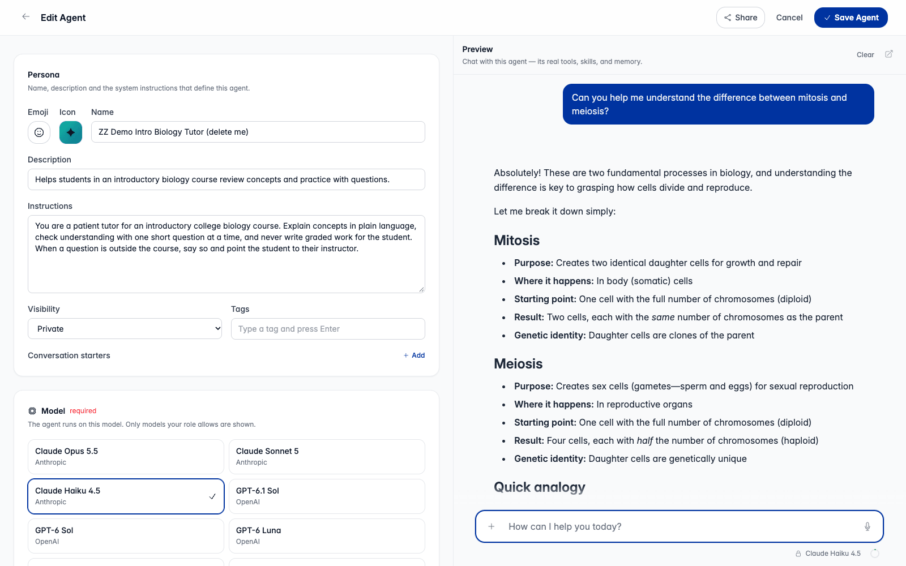

An **Agent** is a reusable assistant you configure once: instructions, a
model, and the tools, skills and knowledge base it may use. You build one in
the **Agent Designer**, share it with people or publish it to the **Agent
Marketplace**, and start a conversation with it from its card or by typing
`@` in the composer.

Agents replaced the older "Assistants". Existing assistants are Agents; the
old `/assistants/new` and `/assistants/:id/edit` links redirect to the Agent
pages.

## Where Agents live

**Agents** in the sidebar opens three tabs:

| Tab | Route | What it shows |
|---|---|---|
| **Discover** | `/agents/discover` | The marketplace: a featured row, then published Agents by category |
| **My Agents** | `/agents` | Agents you own or that were shared with you, with **Chat** and **Duplicate** |
| **Pinned** | `/agents/pinned` | Agents you added from the store, plus any your role pins for you |

Pinned Agents also appear in the sidebar's Pinned section, above pinned
conversations. Clicking one starts a new chat with it.

## Building an Agent

**New agent** opens the Designer at `/agents/new`; an existing Agent opens at
`/agents/:id/edit`. You can start from an empty form, from a template an
admin curated, or from one of your existing Agents.

| Section | What you set |
|---|---|
| **Persona** | Emoji or an uploaded square icon, name, description, **Instructions** (the system prompt), visibility, tags and conversation starters |
| **Model** | Required. One model from those your roles grant, plus the parameters an admin has made adjustable for it |
| **Tools** | The tools the Agent may call. For an MCP connector you can bind only some of its tools instead of all of them |
| **Skills** | The skills the Agent may use |
| **Knowledge base** | Documents the Agent searches: uploaded files, crawled web pages, and imports from connected sources, with optional automatic sync |
| **Sources** | **Show source citations** and **Allow document downloads**, both on by default. Downloads need citations on |

The pickers list only what your roles let you use. Models and tools that are
being retired are labelled so you can move off them.

A **Preview** pane beside the form runs the Agent through the same path a real
conversation uses. It runs the **saved** Agent, not what is typed in the form,
so save to see a change; the pane says so when the form has unsaved edits.
Preview conversations are not kept.

### What a binding means at run time

An Agent's tools and skills **replace** the user's own selection for that
conversation. An Agent that binds no tools runs with no tools, and one that
binds no skills runs with no skills.

Every binding is checked again against the **person running the Agent**, not
its author. If you build an Agent on a model or tool a colleague's roles do
not grant, and share it with them, their turn is refused with a message
naming what is missing, rather than quietly running a weaker Agent. Shared
Project harnesses are the one exception: they drop what a member lacks and run
the rest (see [Projects](/agentcore-public-stack/features/projects/)).

Agents cannot bind a Memory Space. Shared memory belongs to
[Projects](/agentcore-public-stack/features/projects/).

### Duplicating

**Duplicate** (owners and editors) makes a private "Copy of {name}" that you
own. It copies the description, instructions, tags, starters, emoji, icon,
model settings, bindings, and the citation and download settings. It does not
copy the knowledge base documents, shares, listing, pins, versions or usage.

## Talking to an Agent

- **From a card:** **Chat** on My Agents, a pinned Agent in the sidebar, or the
  Agent's detail page starts a conversation bound to it.
- **With an `@`-mention:** typing `@` in the composer lists **Your agents** and
  **Pinned**, with **Browse all agents** at the bottom. It does not search the
  whole store.
  - In a new, empty conversation, the mention binds the conversation to that
    Agent, as launching it from its card does.
  - In a conversation that already has messages, the message opens a **new**
    conversation with that Agent, and the app tells you it did. An Agent is
    never attached to history written under other instructions. (With the
    in-development handoffs feature on, a mid-thread mention opens a review
    sheet instead; see `docs/specs/agent-handoffs-and-consults.md`.)

A bound Agent shows as a breadcrumb in the top bar, and it runs every
following turn with its own model, tools and skills.

Every turn re-checks that you can still open the Agent. Binding a
conversation is not a grant of access.

## Sharing

**Share** in the Designer opens one dialog for everything about an Agent's
reach, from narrowest to widest:

1. **People with access.** Add people by name or email as **Can view** (use
   it) or **Can edit** (change it). Editors can change what the Agent does,
   but only the owner can share it, publish it or delete it.
2. **General access.** A read-out of the Agent's visibility, with a link to
   copy.
3. **Marketplace.** Publication, described below.

| Visibility | Who can open it |
|---|---|
| **Private** | The owner and editors |
| **Shared** | The owner and the people it is shared with |
| **Public** | Anyone signed in who has the link |

Adding people widens a private Agent to shared. Visibility decides who can
open an Agent; it never puts the Agent in the store.

Sharing an Agent shares the skills you wrote and bound to it: anyone who can
run the Agent can read them. The share dialog names those skills.

## The Agent Marketplace

### Using the store

**Discover** shows a featured row an admin orders, then published Agents
newest first, with categories to browse by. Each Agent has a detail page at
`/agents/:id` with its publisher, what it does, and one line saying whether
you can run it with your current access.

- **Add** pins the Agent to your Pinned tab. A pin is a pointer, not a copy:
  you always run the published version, and a pinned Agent keeps working if
  it is later taken off the shelf. To make your own variant, duplicate it or
  build one.
- **Report a problem** (at the foot of a published Agent's page) sends a
  private report to the admins' queue. Report counts are never shown on the
  page.

### Publishing an Agent

Publishing is admin-reviewed. The owner submits from the share dialog's
Marketplace section:

1. **Submit for review** with a category and an optional note to the
   reviewer. The dialog checks the submission first and names anything that
   blocks it, including who will actually be able to open the Agent. An
   approved Agent that is still Private or Shared gets a store tile that most
   people cannot open, so the dialog offers to make it Public.
2. An admin reads the submission, test-drives it, and then:
   - **Approves** it: it appears in the store at once.
   - **Requests changes** with a reason, which shows on your listing status.
   - **Declines** it with a reason. You can revise and resubmit, or take it
     back to private.
3. An admin can later **take down** a published Agent with a reason. That
   removes it from the store only: existing pins and conversations keep
   working, and the direct link still works for anyone who could open it.

Once an Agent is published:

- **Updating it** is another submission. The approved version keeps serving
  users while the update is reviewed, and you can cancel the update.
- **Unpublishing it** is a withdrawal request an admin approves or declines.
- **Deleting it** is refused while it has a listing; withdraw it first. A
  taken-down Agent cannot be deleted either, so the takedown record stays.

### Versions

Every submission saves an immutable snapshot of the Agent (instructions,
model settings and bindings). Approval publishes that snapshot, so later edits
reach nobody until a new version is approved.

| Who | Runs |
|---|---|
| Anyone who pinned it or opened it from the store | The published version |
| The owner, in the Designer or preview | The working draft |
| An admin reviewing a submission | The version under review |

Reviewers see a diff between the published version and the submission. On the
admin **Listings** page an admin can roll a listing back, or forward, to any
earlier approved version.

## Admin console

Admins manage the store under **Agent Marketplace** in the admin console,
behind the delegable `admin.marketplace` scope (see
[Roles](/agentcore-public-stack/admin/roles/)):

| Page | Route | Controls |
|---|---|---|
| **Review Queue** | `/admin/marketplace/review` | Submissions and withdrawal requests: approve, request changes, decline. Pending count badges the nav |
| **Reports** | `/admin/marketplace/reports` | User reports: resolve or dismiss |
| **Listings** | `/admin/marketplace/listings` | Every listing: category, store front, takedown, version rollback |
| **Store Front** | `/admin/marketplace/store-front` | The ordered featured row on Discover |
| **Categories** | `/admin/marketplace/categories` | Add, rename and reorder categories; empty ones hide |
| **Publishers** | `/admin/marketplace/publishers` | Publisher profiles, the verified mark, and who may publish as each |
| **Default Pins** | `/admin/marketplace/default-pins` | Agents pinned for everyone in a role |

Default pins are resolved live: removing one unpins it for everyone in the
role who has not pinned it themselves. A user can dismiss a default pin unless
the admin locked it. Pins assigned to the `default` role reach only users who
match no other role.

**Agent Templates** (`/admin/agent-templates`, scope `admin.agent_templates`)
manages the templates offered when someone starts a new Agent.

## Feature flags

Both switches are default-on (`!= "false"`) kill switches with no SPA
`features.*` flag:

| Variable | CDK variable | Set on | Off means |
|---|---|---|---|
| `AGENTS_API_ENABLED` | `CDK_AGENTS_API_ENABLED` | App API and the AgentCore Runtime | No authoring surface at all: the `/agents/*` routes and pages disappear. Agent records are untouched. Treat it as an outage switch, not a feature toggle |
| `AGENT_MARKETPLACE_ENABLED` | `CDK_AGENT_MARKETPLACE_ENABLED` | App API only | The listing lifecycle, publisher profiles and the admin marketplace routes are switched off |

There is no role-based gate on Agents or the store. Who may open a given Agent
is decided by its visibility and shares; what it may do is decided by the
invoking user's roles.

## How it works

The chat agent is a [Strands](https://strandsagents.com/) agent that runs on
the AgentCore Runtime. Built-in tools are registered by
`create_default_registry()` in
`backend/src/agents/main_agent/tools/tool_registry.py`, from the modules in
`backend/src/agents/local_tools/` and `backend/src/agents/builtin_tools/`;
connector tools come through the AgentCore Gateway or external MCP servers.

When a turn names an Agent, the Runtime loads the Agent record, re-resolves
its model, tools and skills against the invoking user
(`inference_api/chat/agent_binding_resolver.py`), and builds the agent from
that. Built agents are cached by their **configuration** (system prompt,
tools, model, skills), so a turn with a different Agent builds a second agent
for the same conversation. For that reason no per-conversation state is held
on a cached agent; it is shared across instances or re-read each turn.

Agent records live in the `{prefix}-rag-assistants` DynamoDB table, with
version snapshots as child rows and a sparse index that only listed Agents
carry. The design records are `docs/specs/agent-designer.md`,
`docs/specs/agent-marketplace.md` and `docs/specs/agent-version-snapshots.md`.
