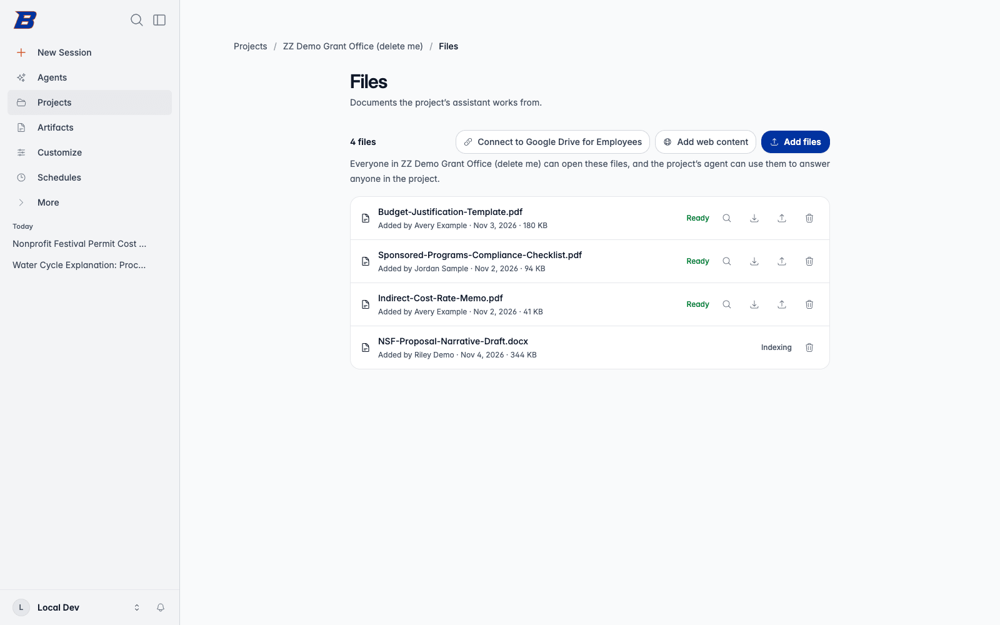

An agent can carry a knowledge base: documents its owner adds, which the agent
answers from with citations. A Shared Project's **Files** are the same thing,
held by the project's harness agent and shared by its members. On every turn
the platform searches the knowledge base for the user's message and hands the
best passages to the model, or, for a small knowledge base and when switched
on, the whole of it.

There is no flag for knowledge bases themselves. They are part of agents and
projects.

## Where users add documents

| Surface | Where | Who can add |
|---|---|---|
| An agent | The **Knowledge base** section of the agent form (`/agents/new`, `/agents/:id/edit`) | The agent's owner, or someone it is shared with as an editor |
| A project | The project's **Files** page | Project editors. Viewers can list and download |

The knowledge base section's **Add content** row offers three ways in:

- **Add files** from the device (or drag and drop, up to 10 MB in the SPA).
  The SPA asks `POST /assistants/{id}/documents/upload-url` for a presigned S3
  URL, uploads straight to the documents bucket, and the document starts at
  `uploading`.
- **Import** from a connected file source, such as Google Drive (a button per
  connector, which offers to connect it first if needed). A file source
  is a [connector](/agentcore-public-stack/admin/connectors/) an admin has
  mapped to a file-source adapter. The import records where the file came from,
  which is what lets it be synced later.
- **Add web content**: a bounded crawl from a start URL (depth up to 3, up to
  100 pages, up to 5 concurrent fetches, with a delay between requests).

Each document shows its status, can be downloaded, deleted or replaced with a
newer version, and has a **View extracted content** view of the text that was
indexed. The agent form's **Sources** section has **Show source citations**;
with it off, no citation cards are shown or stored for that agent's answers.

## Two engines

Every knowledge base is served by one of two engines. Callers never learn
which; one seam (`apis/shared/kb_backend/`) resolves it from the knowledge
base's record, and a missing or unreadable record means classic.

| | Classic | Managed |
|---|---|---|
| Store | One shared Amazon S3 Vectors index | One Amazon Bedrock managed knowledge base per agent or project |
| Ingestion | The `rag-ingestion` Lambda | Bedrock's own parser, driven by the managed ingestion consumer |
| Search | Vector similarity, top 5 | Bedrock retrieval with managed reranking, top 5 |
| Passages sent to the model | Up to 22,000 characters | Up to 8,000 characters (Bedrock's chunks run larger) |
| Storage cost | About $0.15/GB-month (S3 plus S3 Vectors) | $5.00/GB-month of raw data |
| Byte caps | None | Per owner and per knowledge base (see Limits) |

**Projects always use managed.** A project's first file starts provisioning
its managed knowledge base, and a file is refused rather than added to a
classic one. That requires `CDK_MANAGED_KB_NEW_DEFAULT` to be on.

**New agents** get a managed knowledge base only while
`CDK_MANAGED_KB_NEW_DEFAULT` is on (off by default). Provisioning starts at the
agent's first document, not at creation, so prompt-only agents and abandoned
drafts never spend one of the account's Bedrock knowledge bases. Creating one
takes a few minutes; the first document shows `provisioning` until it exists.
An agent that already holds classic documents stays classic.

**Existing agents** can move to managed when
`CDK_MANAGED_KB_MIGRATION_ENABLED` is on (off by default). The knowledge base
section then offers its owner and editors **Upgrade knowledge base**. The
knowledge base keeps working normally while the upgrade runs.

Both flags are off unless set, and both carry real storage cost. See
[Feature Flags](/agentcore-public-stack/configuration/feature-flags/) for the
managed reconcilers, caps and cost alarms.

## The rag-ingestion Lambda

Classic ingestion runs in the `rag-ingestion` Lambda, a container image built
from `backend/Dockerfile.rag-ingestion`. CDK owns the function's
configuration; the image ships out of band from `backend.yml`, like the other
backend images. An S3 `ObjectCreated` event on the documents bucket's
`assistants/` prefix starts it.

For each document it:

1. Checks which engine owns the knowledge base. A managed one is skipped
   entirely, without touching the document's status, because the managed
   consumer owns it.
2. Downloads the file and refuses anything over 20 MB.
3. Parses and chunks it with Docling, layout-aware, at about 1,024 tokens a
   chunk with headings prepended (status `chunking`, with a running chunk
   count). Spreadsheets and CSV files have their own chunkers.
4. Embeds the chunks with Amazon Titan Text Embeddings V2 (status `embedding`).
5. Writes the vectors to the S3 Vectors index, keyed `{document_id}#{i}`, and
   marks the document `complete`.

Any failure marks the document `failed` with the error. Supported formats are
PDF, Word (`.docx`, `.doc`, `.odt`), PowerPoint (`.pptx`), Excel (`.xlsx`),
CSV, text, Markdown, RTF, HTML, XML, JSON and AsciiDoc.

A managed document goes through the managed ingestion consumer instead, on an
EventBridge event for the same upload. It is marked `complete` only once a
retrieval actually returns it, not when Bedrock first reports it indexed.

Only `complete` documents are ever retrieved.

## Retrieval at turn time

On a turn with an agent or project that has a knowledge base, the runtime
searches it with the user's message, five results, after resolving that the
user may read it. The passages are added to the user message, up to the
engine's character cap, and also become the turn's citation cards.

The search starts early and is awaited after the agent build, so it overlaps
the build rather than adding to the time to first token
(`KB_SEARCH_AHEAD_ENABLED`, a rollout switch that is on). A failed search
never fails the turn: the turn runs without retrieved context.

A project turn also gets the `project_files` tool, which lists the project's
Files and reads one by name. Retrieval answers "what does the playbook say
about X"; it cannot answer "grade submission 7", which needs a file.

### Full-context mode for small knowledge bases

Retrieval hands the model the few passages closest to the wording of the
question. For a small knowledge base whose answer depends on which document
applies ("Can I use AI on my assignment?" when the policy differs by
assignment), that can answer from the wrong one. Full-context mode sends the
whole knowledge base instead.

When every `complete` document has extractable text and together they fit the
token budget, the full text goes at the end of the system prompt as one
`<knowledge_base>` block, and the user message is not augmented. Retrieval
still runs, for the citation cards. The block is deterministic, so it is
cached with the system prompt and changes only when a document is added,
changed or removed. Anything over budget, any document without a text layer
(such as a scan), or any error falls back to retrieval.

| Variable | Where | Default | Purpose |
|---|---|---|---|
| `CDK_ASSISTANT_KB_FULL_CONTEXT_ENABLED` | AgentCore Runtime | off | In development: only `"true"` enables it. No SPA flag |
| `ASSISTANT_KB_FULL_CONTEXT_MAX_TOKENS` | AgentCore Runtime | 50,000 | The token budget. `0` switches the mode off |

### Project file readiness

A project's file can take minutes to index. With
`CDK_PROJECT_FILE_READINESS_ENABLED` (in development: only `"true"` enables;
SPA `features.projectFileReadiness`), a turn whose project has files still
being prepared, or failed, gets a short note in the user message naming them,
and the project chat shows a readiness strip above the composer. A turn whose
files are all ready is unchanged.

## Keeping sources in sync

A document imported from Google Drive, or a crawled website, can be kept fresh
on a schedule: the sync control next to it offers **Don't auto-sync**, **Sync
daily**, **Sync weekly** or **Sync monthly**. Choosing an interval creates a
sync policy, and the control then shows its status with **Sync now**,
**Pause**, **Resume** or **Reconnect** as fits. Device uploads have no
source to refetch, so they show no control.

One EventBridge rule fires the kb-sync dispatcher every 15 minutes. It reads
the policies that are due and invokes the kb-sync worker for each, which checks
the source and re-ingests through the normal pipeline only when the content
changed. An unchanged source costs one metadata check per run.

The design (`docs/specs/assistant-kb-sync.md` §7) is built so a sync never
runs away:

| Guard | Behaviour |
|---|---|
| One trigger | Only the dispatcher starts work. Deleting a policy stops it completely |
| Liveness | A policy whose agent or source is gone is deleted when it comes due |
| Inactivity | An agent unused for 30 days pauses its policies; the next use resumes them |
| Failures | Back off exponentially (capped at 30 days); 5 in a row pause the policy |
| Source gone | A Drive file not found twice pauses the policy. Indexed content is kept |
| Consent gone | A revoked or expired Drive grant pauses the policy until the user reconnects |
| Bounds | At most 10 policies per agent, 20 dispatched per tick, intervals no shorter than a day |

**Sync now** queues a run through the same dispatcher, at most once every 10
minutes per policy. The API is `/assistants/{id}/sync-policies` on the App API
(owner or editor), and a project's Files page uses the same routes for its
harness.

`CDK_KB_SYNC_ENABLED` turns the whole mechanism on or off. It is on by
default; turning it off stops all sync activity within one tick and changes no
data.

### Drive folders

A knowledge base can also follow a whole Google Drive folder. **Save as
project** on a folder chip offers **Keep in sync with the folder**, and the
project's Files page then lists it under **Synced folders** with its schedule.

Each run re-lists the folder, re-ingests a file only when its Drive version
and then its bytes changed, imports new files, and marks files that left the
folder without deleting them. A file someone removed from the knowledge base
is never imported again. A run downloads at most 50 files and 250 MB in 12
minutes and leaves the rest for the next run.

Folder sync is a feature switch, on by default (`!= "false"`):
`CDK_FOLDER_SYNC_ENABLED` sets `FOLDER_SYNC_ENABLED` on the App API and both
kb-sync Lambdas, and the SPA's `features.folderSync` shows the option. It needs
KB sync on. While it is off, a new folder policy is refused and a due one is
re-armed without running. See `docs/specs/assistant-kb-sync.md` §11.

## Limits

| Limit | Value |
|---|---|
| Upload size in the SPA | 10 MB |
| File size the classic pipeline accepts | 20 MB |
| Website crawl | Depth 3, 100 pages, 5 concurrent fetches |
| Passages retrieved per turn | 5 |
| Managed byte cap, per owner | 100 MB standard, 1 GB elevated (`CDK_MANAGED_KB_PER_OWNER_BYTES`, `CDK_MANAGED_KB_PER_OWNER_ELEVATED_BYTES`) |
| Managed byte cap, per knowledge base | 500 MB (`CDK_MANAGED_KB_PER_KB_CEILING_BYTES`) |

Bytes are reserved before a managed upload is accepted, so an upload over the
cap is refused with a 413 that says how far over it is, and concurrent uploads
cannot collectively pass it. The knowledge base section shows a usage bar.

## Other knowledge bases the platform keeps

Two features index content into their own managed knowledge bases. Neither is
attached to an agent, and both are separate decisions:

- **Attachments KB** (`CDK_ATTACHMENT_KB_ENABLED`, SPA
  `features.attachmentKb`, in development: only `"true"` enables). Large
  documents attached to a conversation are indexed so `document_read` can
  search them by meaning and return excerpts with page numbers. It requires
  large document attachments. See `docs/specs/large-document-attachments.md`.
- **Conversation index** (`CDK_CONVERSATION_INDEX_ENABLED`, in development:
  only `"true"` enables). Each turn's text is archived and indexed for
  full-text conversation search. See `docs/specs/conversation-search.md`.
