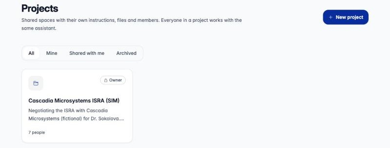
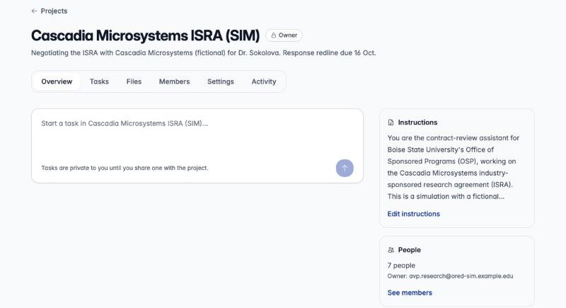

A **project** is a shared workspace for a team that works on the same thing,
such as a contract negotiation, a grant proposal or a course redesign. Everyone in
the project works with **the same assistant**: one set of instructions, one set of
files, one set of tools, and a memory the whole team can build up.

Use a project when two or more people keep asking an assistant about the same
documents, or keep re-explaining the same ground rules. Set it up once, and
every member's conversations start from the same place.

:::note[Is it turned on?]
Projects are opt-in for each deployment. If you don't see **Projects** in the
sidebar menu, or `/projects` shows a "not found" page, ask your administrator.
:::

## What's shared and what's yours

| Shared with everyone in the project | Private to you |
| --- | --- |
| The assistant's **instructions**, **model**, **tools** and **skills** | Your **conversations** until you share one |
| The project's **files** | Files you attach to one of your conversations |
| **Project memory** the team builds up | Your **"just for me"** memory in this project |
| Conversations someone has **shared with the project** | Your **personal instructions** (Settings › Chat) |
| The member list and, for editors, the **Activity** trail | Files the assistant creates for you in a conversation |

Each conversation you start in a project stays private to you until you share
it. Sharing posts a read-only **snapshot**, and teammates can pick it up as a
copy in a conversation of their own.

## Roles

Everyone in a project has one role. People are added by email, so you can add a
colleague before they have ever signed in. The project is waiting for them
when they do.

| | Viewer | Editor | Owner |
| --- | :---: | :---: | :---: |
| Open the project, its files and shared conversations | ✓ | ✓ | ✓ |
| Start conversations with the project's assistant | ✓ | ✓ | ✓ |
| Share their own conversations with the project | ✓ | ✓ | ✓ |
| Download files | ✓ | ✓ | ✓ |
| Save things to their own "just for me" memory | ✓ | ✓ | ✓ |
| Add and delete files | | ✓ | ✓ |
| Save to project memory (through the assistant) | | ✓ | ✓ |
| Change instructions, model, tools and skills | | ✓ | ✓ |
| Rename the project, edit its description | | ✓ | ✓ |
| Add, remove and change members | | ✓ *(unless the owner turns this off)* | ✓ |
| See the Activity trail | | ✓ | ✓ |
| Archive, restore, delete, transfer ownership | | | ✓ |

- **There is exactly one owner.** The owner can hand the project to an editor,
  who must have signed in at least once (they don't need to have opened the
  project). The old owner becomes an editor.
- **Anyone except the owner can leave** a project from the project menu (the
  project's name at the top of its page).
- **Picking roles:** make people who shape the work *editors* (they set the
  assistant up and curate files). Make people who mainly need answers, such as
  reviewers, stakeholders and advisors, *viewers*. Viewers can still start
  conversations and share them.

## The project page

At the top of a project's page is a composer for starting a new conversation in
the project. Beneath it are two lists:

- **Recents**: your own conversations in the project, newest first.
- **Shared with the project**: conversations anyone has shared with the team.

Beside them, a rail lists the project's settings, one row each:
**Instructions**, **Files**, **Memory**, **Model**, **Tools**, **Skills**,
**Schedules**, **Members**, **Activity** *(editors and owner only)* and
**History**. Each row shows a one-line summary and opens that setting's page.
**Model** is the exception: it's a menu on its row.

The menu on the project's name, at the top of the page, renames the project,
archives or restores it, deletes it once archived, or lets you leave it.

Project conversations also appear in the main sidebar, grouped under a small
heading with the project's name.

You can also start one without opening the project. In a new conversation,
**Project or folder** beneath the message box lists your projects: pick one and
the conversation runs in it, keeping anything you have already typed. **No
project** undoes the choice, and **New project** creates one and starts the
conversation there. The choice is fixed once you send the first message.
Where folder attachments are on, the same list also shows the Google Drive
folders you attached recently: pick one to attach it to the new conversation.

A folder you keep coming back to can become a project. On a message that
carries the folder, select **Save as project** beside its name. The new project
gets a copy of the folder's files in its Files. Files added to the folder or
changed in Drive later aren't picked up.

## Next steps

- [Set up a project](/agentcore-public-stack/user-guide/projects/set-up/): create it,
  write instructions, add files and invite your team.
- [Work together](/agentcore-public-stack/user-guide/projects/work-together/):
  conversations, sharing, memory, attachments and Word documents.
- [Example: negotiating a research agreement](/agentcore-public-stack/user-guide/projects/example-contract-negotiation/):
  a full walkthrough with a seven-person team.
- [Tips and current limits](/agentcore-public-stack/user-guide/projects/tips-and-limits/).
